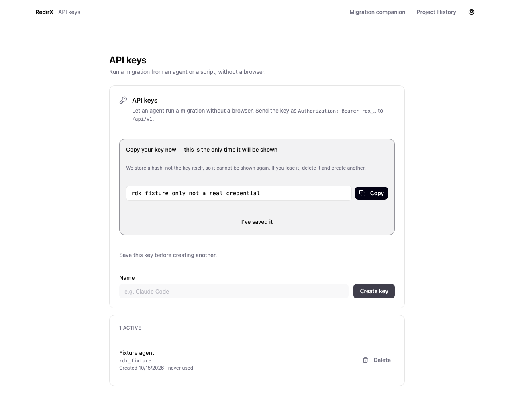
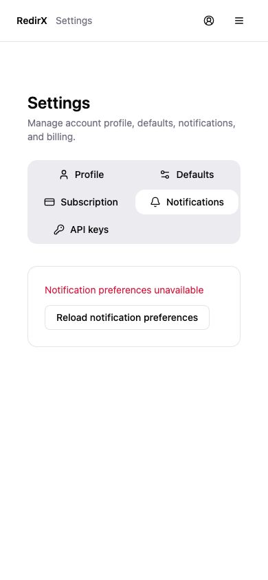

# Account, API key and historical billing recovery

Based on integration commit `1a5ea75`. This package has no dependency on the
subsequent auth/connection package. No backend account settings, billing policy,
provider services, database migrations or deployment were changed.

## User-visible improvements

API keys cannot be replaced by clicking Create or pressing Enter before the
current one-time secret is acknowledged. Creation has an immediate duplicate-call
guard and no retries. The plaintext lives only in mounted reveal state: mutation
results resolve without it, inventory responses select metadata fields, and the
reveal uses the installed analytics SDK's `ph-no-capture`/`ph-mask` classes.
Acknowledgment clears the reveal; switching owners discards local state and late
plaintext results. A failed deletion keeps its dialog and error visible, with
explicit recovery instead of disappearing as though it succeeded. List reads
have a reload action. API responses require positive success and valid metadata;
an incomplete list no longer means “no keys,” and a false deletion response no
longer triggers a success toast.

Account, key and settings queries now include the authenticated owner in their
cache keys. Their component state remounts by owner; late mutation callbacks do
not navigate or notify after unmount. New `forOwner` helpers preserve existing
query-key prefixes for broad invalidation. `sessions.forOwner` is available for
the project-history surface to adopt. These particular reads use explicit retry
UI instead of background retry, preventing a retired owner query retry from
obtaining a newer account's token. Other query defaults are unchanged.

Settings no longer exposes editable default notification values after a failed
read. Partial preference saves wait for both requests, report uncertainty and
refresh persisted state. Billing return query parameters now say payment is
unconfirmed rather than claiming Checkout completed. Historical billing management
remains available; no new purchase or subscription is enabled. Legacy `tab=billing`
links work, unknown tabs fall back to Profile, and the invalid historical
`htaccess` export default normalizes to the actual `apache` exporter. Format
choices are constrained to the existing historical exporters. Defaults explicitly
state they do not approve Jev proposals.

Pivot-mode account/settings reuse the existing responsive ToolLayout. All settings
tabs remain visible at mobile width. Account read failures offer recovery and do
not masquerade as an empty project history, a known plan, or an editable complete
profile. Signed-in free API-key access remains supported.

A fixture browser run also found the local Vite `/api` proxy swallowed the SPA's
`/api-keys` route. Narrowing it to `/api/` fixes direct navigation and refresh while
keeping actual API routes proxied. Production routing is not modified.

## Evidence

- **70 targeted tests passed** across App routes, API key transport/panel, Settings
  and AccountPage. The final five-suite run passed 69; the follow-up key transport/
  panel run passed 17 after adding one inventory-secret regression.
- Positive cache inspection tests verify no plaintext in the entire mutation state
  after creation and after an owner switch. Owner-switch tests verify separate
  metadata/profile/session/billing reads and suppress late old-owner secrets.
- **Two Chromium fixture journeys passed** at 1280×900 and 390×844: free account
  key creation → protected reveal → acknowledgment → failed delete recovery →
  notification read failure → account. They assert only one create/delete call,
  no false preference save action, visible mobile active tab, no horizontal
  overflow, no page errors and no unexpected API calls.
- All non-local browser requests were blocked. Session, user and key data were
  synthetic. The apparent key in screenshots is explicitly a noncredential.
- Frontend production build passed. Existing large-chunk warning remains. This
  is not a frontend TypeScript check.
- Impeccable detector returned no findings on the changed components.
- `git diff --check` passed.

The first browser attempt exposed the Vite proxy collision; the next caught an
incorrect test fixture route (`/api/sessions` versus `/api/user/sessions`). Both
were corrected, then the desktop/mobile journeys passed. A final visual pass made
all mobile tabs visible and repeated the passing journeys. Desktop key reveal
and final mobile settings were inspected.

```sh
npm exec --prefix frontend -- playwright test --config frontend/playwright.account.config.ts
```





## Remaining work

This is scoped owner isolation, not a global query-cache lifecycle fix. Dashboard,
project history, Watch, GSC and historical review queries still need their own
owner boundaries or a carefully tested shared solution; a naive app remount can
break OAuth callback completion. Other old-owner caches remain in browser memory
until their normal GC, although these account surfaces cannot read them under a
new owner's keys. One-time keys are deliberately not persisted across navigation
or reload; losing an unsaved reveal still requires revocation/replacement.

Existing Radix wrapper ref warnings remain; common focus primitives were left to
the separately assigned surface work. Real analytics masking, actual clipboard
integration, real billing/checkout, production ownership enforcement, physical
mobile devices and end-to-end live API operations were not exercised. Tests used
Node25.8.1 and existing dependencies via an untracked symlink, not a clean install
or release-Node parity run. No `.env` files or credentials were copied.
