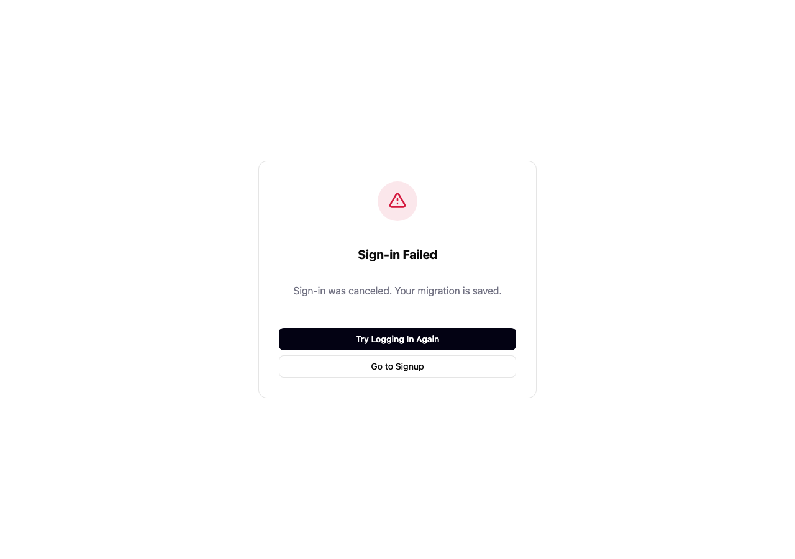
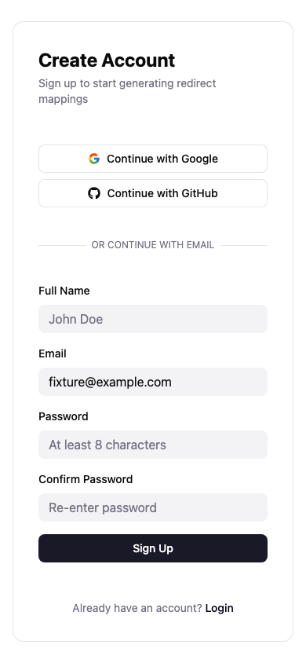

# Sign-in and connection recovery

This package is independent of the MCP structured-output package. It changes
browser auth components and MCP delegation resolution; no backend routes,
OAuth issuer/resource policy, account settings or deployment are changed.

## Problems corrected

- Consent previously redirected a visitor to login while their existing account
  was still loading. It now waits for hydration and offers profile-load recovery
  without discarding the saved sign-in or connection request.
- Consent read/network failures had no local recovery. Reads and decisions now
  have a 15-second UI wait limit; the recovery action reloads authorization state,
  never automatically repeats approval or denial. Timed-out requests can still
  finish upstream: their outcome is explicitly unconfirmed. Late results after
  leaving the page or changing request/account cannot redirect the browser.
- Failed callback recovery now carries the sanitized saved migration/consent
  path into both login and signup. Provider error text is decoded once rather
  than corrupting literal percent/plus characters through a second decode.
- Login/signup labels now name their actual form controls. Email validation and
  callback errors are announced, and long callback/client text can wrap.
- A stalled MCP delegation request previously trapped every coalesced caller
  indefinitely. Its shared request now has a 10-second header/body deadline.
  Failure evicts the in-flight entry so an explicit later request can recover.
  No hidden retry is added, and one caller does not cancel other callers' shared
  resolution. Responses must match the verified subject and expected schema
  before caching; upstream body/transport details never enter error messages.

## Verification

Executed in an isolated clone using Node 25.8.1 and existing installed dependencies
via untracked symlinks; no `.env` files or production credentials were copied.

- Full MCP suite: **95 tests passed, zero skipped** (local OAuth fixture server).
- Targeted browser auth suites: **58 tests passed** across auth context, callback,
  consent, login, signup and redirect sanitization. This combines the 57-test run
  and the final 11-test consent run after adding the stale-completion regression.
- MCP TypeScript check and build: passed.
- Frontend production build: passed (existing large-chunk warning remains).
  A Vite build is not a frontend TypeScript check.
- Fixture-only Chromium: **two journeys passed**, 1280×900 desktop and 390×844
  emulated mobile, on a separate loopback preview port. All non-local requests
  were blocked. Tests verify callback error → login → signup, exact migration
  return path, accessible form names, no horizontal overflow and no page errors.
- Impeccable detector: no findings for the four changed UI components.
- `git diff --check`: passed.

Repeat the browser check with:

```sh
npm exec --prefix frontend -- playwright test --config frontend/playwright.auth.config.ts
```

The six generated screenshots were batched in one browser run. Desktop callback
and mobile signup were visually inspected; retained samples:





## Boundaries

Consent behavior is exercised with component SDK fixtures; the browser run uses
signed-out callback/login/signup routes, not a live OAuth grant. No real provider,
backend account mutation, production browser/client acceptance, physical mobile
device or model calls were exercised. Supabase OAuth APIs expose no AbortSignal;
the 15-second UI deadline ignores late results but cannot undo consent upstream.
The broker's transactional protocol and issuer/audience/resource checks are
unchanged. Generic/development token verifier network deadlines and full browser
profile-fetch deadlines remain separate follow-up work.
