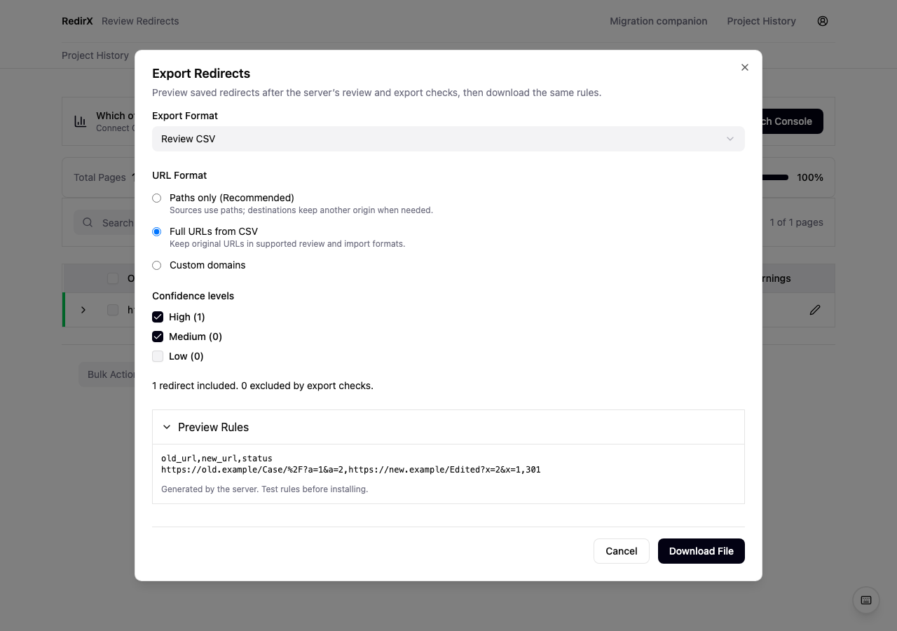
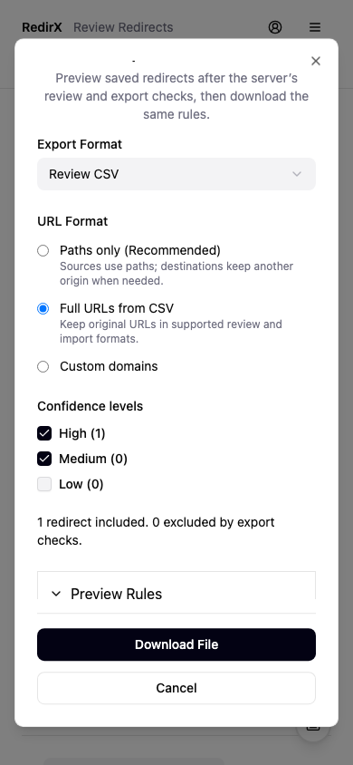

# Historical review and export receipt — 2026-10-16

This package replaces the historical browser's independent export renderer with the existing server renderer, and makes review saves truthful and account-scoped. Nothing was deployed or exercised against live accounts, model services, sites, payment services, or databases.

## Dependency and scope

Started from integration `293a640`, with account package `4e03eff` locally cherry-picked as `5682eaa`. Root's serializer package `7441f46` is locally cherry-picked as `91a4e92`. Integrate this package after those two packages; do not repeat their local cherry-picks.

Owned changes: historical ReviewInterface, table/toolbar, edit/export/help dialogs, PricingPage recovery, their API clients/query helpers, and the existing historical export route. The orchestrator approved the export-route extension after confirming that keeping a browser serializer would bypass the existing server selector and entitlement check.

## Behavior and evidence

- Review decisions no longer update exportable state or toast success before a positive `{success:true}` acknowledgment. Single-row, target edits and accepted repairs use the same save path. Changing a target removes its old approval; changing an unpersisted confidence band is no longer offered. The model score remains evidence.
- Bulk review writes have at most four requests in flight. Only confirmed changes update rows and the owned result cache. Failed rows remain selected. A failed or timed-out response means an unknown outcome, not a rollback. The last confirmed snapshot remains visible, and a successful server readback is required before further edits or export. No automatic mutation retry is added. The 20-second mutation deadline covers response-body consumption as well as fetch.
- Results, preview and historical purchase-status queries include owner identity. The owner/session-keyed review mount discards drafts, dialogs, selections and traffic metadata on changes. Read signals are consumed and automatic query retry is disabled for these owner-sensitive reads; explicit reload UI is the tradeoff. Late mutation completions do not affect the next owner, toast success there, or launch the next queued bulk request.
- Existing query prefixes remain usable for broad invalidation. New helpers: `results.forOwner(owner, sessionId)`, `results.deepPreviewForOwner(owner, sessionId)`, `billing.unlockStatusForOwner(owner, sessionId)`, `billing.quoteForOwner(owner, sessionId)`.
- Clear Selection works. Search has a real input ref. Review shortcuts do not act through an open dialog. Native input select-all is preserved. Table icon controls have names. Failed edits keep their draft and inline recovery message; saving blocks dismissal and duplicate submission.
- Four focus/ref tests failed against the old React 18 wrappers and passed after narrowly forwarding Input, dialog/sheet trigger/close/overlay/content, and alert-dialog trigger/overlay/content/action/cancel refs. Browser evidence confirms focus containment and return to the opening Edit/Export controls.

## One authoritative export path

`GET /api/results/:session_id/export` retains its existing format, ownership, entitlement and download behavior. Optional `preview=true` returns the exact generated content plus filename, content type, included count, excluded count/reasons and platform warning. Preview is gated before any rows are read, and does not record an export. Responses are private/no-store. Unsupported serializer inputs return a recoverable 422 with `unsupported_export_input` rather than a 500.

Optional `confidence_levels=high,medium,low` supports the browser's arbitrary subset; callers that omit it retain existing `min_confidence` defaults. It calls the existing results formatter's band function (medium starts at 0.65). `url_format=custom` passes validated origins to the existing serializer; it does not reinterpret unsupported platform combinations. The old `htaccess` browser default resolves to `apache`; unknown defaults require selection.

The modal no longer builds Apache, Nginx, platform JSON or CSV locally. It surfaces server exclusions and validation, including query-sensitive/normalization-sensitive sources that cannot safely be represented. Review CSV/JSON expose the server's existing lossless formats. The server selector remains unchanged: explicit held/rejected/needs_review or false approval/validation rows are excluded, while historical rows without decision fields retain existing compatibility. This does **not** impose a new Jev audited-approval policy on historical rows.

Download fetches the same selection again and compares bytes to the displayed preview. A difference requires refresh and review before download. A malformed preview, HTML fallback, denied/unsupported response, interrupted request or browser initiation failure never falls back to a client renderer or success toast. Requests are bounded at 20 seconds, including body consumption. Late results after owner/unmount disposal are discarded. Browser success means **Download started**, not saved to disk, installed, or verified. Anchors and object URLs are disposed. Tutorial progress failure cannot turn an already-started download into a false download failure.

This converges with the root's native Apache/Nginx investigation and serializer refusal rules in [the runtime receipt](../research/export-runtime/README.md). Official source references that motivated convergence: [Apache redirect semantics](https://httpd.apache.org/docs/2.4/en/mod/mod_alias.html), [Vercel query matching](https://vercel.com/kb/guide/how-do-i-perform-vercel-redirects-based-on-query-strings).

## Historical purchase handoffs

PricingPage now resets local checkout state on owner/project changes, scopes quotes/status cache, consumes cancellation for status reads, and ignores retired-owner checkout completions. Acquisition remains completely unmounted in pivot mode. Query-string payment claims are not trusted; historical results remain reachable from server-confirmed state. Existing prices, checkout creation and quote semantics remain unchanged.

Read-only audit of SubscriptionCheckoutPanel/PivotBillingNotice confirmed explicit recurring consent, pinned test-only notice, request-scope retry keys and checkout readback. DeepMatchPreviewCard only routes through an encoded historical pricing query and is not mounted by pivot review. No new Jev paid offer or deferred SQL activation is introduced.

## Verification

- **96 frontend tests passed across 14 files**: review lifecycle and zero-traffic behavior; export defaults/recovery/API contracts; positive acknowledgment, timeout, raw target and ownership cases; PricingPage owner changes and historical compatibility; focus primitives; account/key/settings and deep-preview regressions.
- **7 Flask route tests passed**, using the real selector/renderer and mocked ownership/auth/entitlement/database boundaries. Positive proof: preview/download identical bytes, exact included/excluded counts, arbitrary confidence subsets including the 0.65 cutoff, custom-origin preservation, permission/entitlement before data access, actionable 422, and unchanged default/min-confidence selection.
- **2 Chromium journeys passed**, 1280×900 and 390×844 fixture viewports. Covered uncertain save/readback, approval save, target-edit approval reset, blocked zero-row export, server refusal, lossless CSV preview/download bytes and filename, keyboard search, modal shortcut boundaries, tab focus containment, opening-control focus return, no page errors, no unexpected API calls, no React ref warnings, and no document horizontal overflow. All non-local network requests were blocked.
- Vite production build completed as part of each browser run. This is not a TypeScript type-check claim. Existing large-chunk warning remains.
- `git diff --check` passed. Impeccable detector ran once; it reported only existing table accent borders and width animation. These incumbent row-state visuals were retained rather than changing unrelated styling.

Browser command: `npm exec --prefix frontend -- playwright test --config frontend/playwright.review.config.ts`.

Backend tests used `/private/tmp/redirx-checkout-venv/bin/python` with `dotenv.load_dotenv` patched off and `POSTHOG_API_KEY=''`; no `.env` was copied or loaded. Local Node is 25.8.1 and Python is 3.14.6, not release Node 24/Python 3.12 parity. Screenshots below are synthetic data and viewport emulation, not physical-device testing.

## Remaining limits

- Shared query caches retain old owners' data until garbage collection; scoped keys stop these surfaces from rendering it. Global auth/query lifecycle remains the dedicated shared-shell workstream.
- SubscriptionCheckoutPanel's standalone scope does not include owner, and the current PivotMigrationDetail mount was keyed only by migration ID. Root was notified to cover the whole companion/detail boundary in its next pass; this package does not edit that shared surface.
- Historical PATCH decisions are explicit setters without optimistic revision checks. Two independently open reviewers can still overwrite each other's choices; the export byte comparison prevents a file differing from its current displayed preview, but is not a database revision-lock protocol.
- Historical export counters record server generation as before; an abandoned response or a download rejected because its bytes changed may increment the counter even though no browser download starts. Preview itself does not increment it.
- Approval/export now obeys the pre-existing server entitlement and selector. Historical browser-only exports that previously bypassed those checks will receive their existing denial/exclusion instead. No billing rules were changed.
- Browser screenshots do not validate installation or all six platform runtimes. Apache/Nginx runtime evidence belongs to the linked root serializer receipt; other platform validation remains that service's documented policy.

## Independent follow-up

Custom export origins now use `inventory_policy.normalize_origin` for validation only, retaining supplied origin spelling in the renderer. DEL, malformed hostname labels, empty ports and query/fragment delimiters are rejected consistently. A positive route test retains mixed-case host, explicit default port and the raw path/query/fragment suffix. Historical rows with no decision fields remain exportable; the browser's advisory now defers exclusion claims to authoritative preview counts.

Validation: 9 historical export route tests and 22 export modal tests pass. Independent review of root export packages `7441f46` / `6de3e40` found no blocker; 58 serializer/artifact/route-outcome tests passed. Native Apache/Nginx evidence was read, not rerun here. Root `dev.py` process ownership patch was read and its two disposable native process tests independently passed; Windows descendant cleanup remains explicitly unverified.
